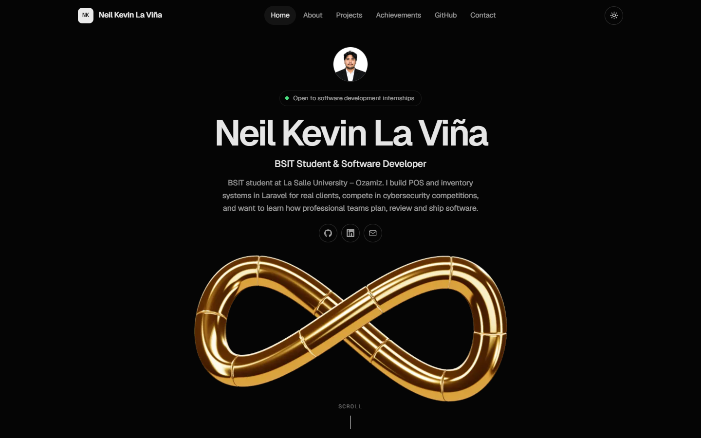

# Neil Kevin La Viña | Portfolio

My portfolio website for the Skills Showcase Challenge (Web Development Intern). It's a single-page site made with plain HTML, CSS and JavaScript.

Live site: https://hannya-man.github.io/portfolio/

What's on it
- Home: my photo, a short bio and links to my GitHub, LinkedIn and email, followed by a gold infinity loop that comes apart as you scroll to show its core, then locks back together
- About: a bit about me and the tools I use
- Projects: my capstone, freelance and personal projects, with demo and source links where available
- Achievements: competitions, certifications, leadership and trainings (click a photo to see it bigger)
- GitHub: my latest public repos, loaded from the GitHub API
- Contact: a form that checks your input and shows a success message (no email is actually sent)

Other features:
- Works on phones, tablets and desktops
- Dark by default, with a light mode toggle that remembers your choice
- Scroll-driven infinity loop animation: 60 pre-rendered frames drawn on a canvas, with a loading screen while they download
- Scroll animations and hover effects
- Projects can be filtered by category

Built with
- HTML, CSS and JavaScript
- GitHub REST API
- three.js (used to model the infinity loop and render the animation frames, see `tools/infinity/`)
- Google Fonts (Geist and Geist Mono)

Credits
- Event photos from [LSU SOURCE](https://lsu-source.org), La Salle University – Ozamiz
- Icons from [Lucide](https://lucide.dev) and [Simple Icons](https://simpleicons.org)
- Fonts from [Google Fonts](https://fonts.google.com)
